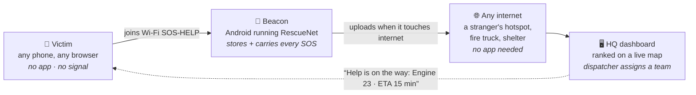
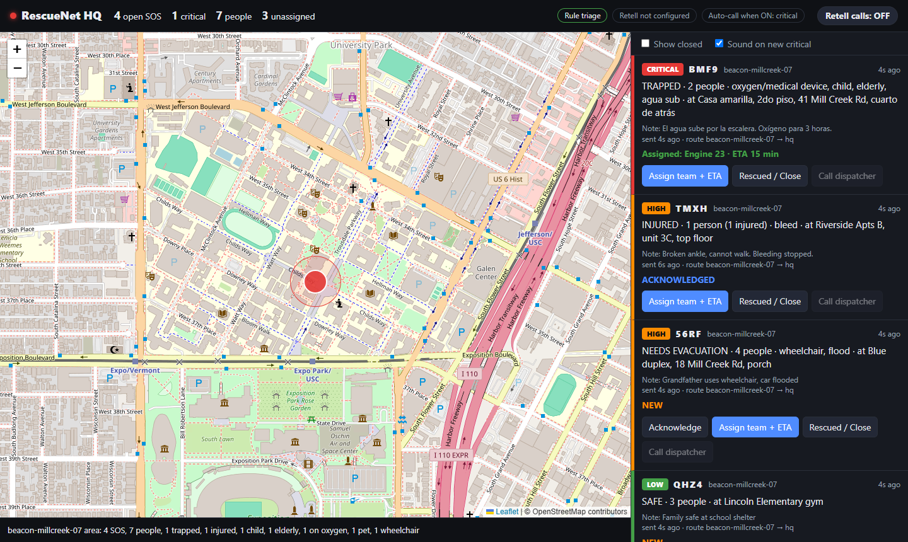
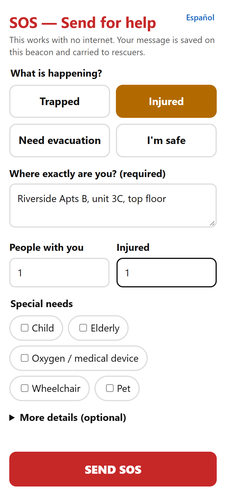
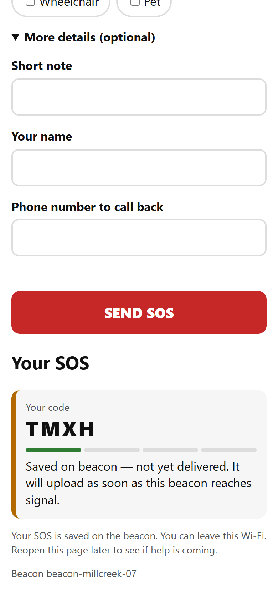
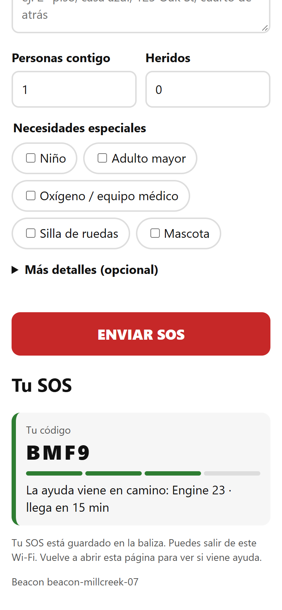
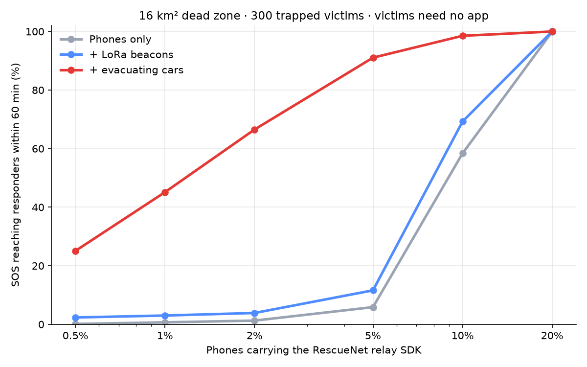
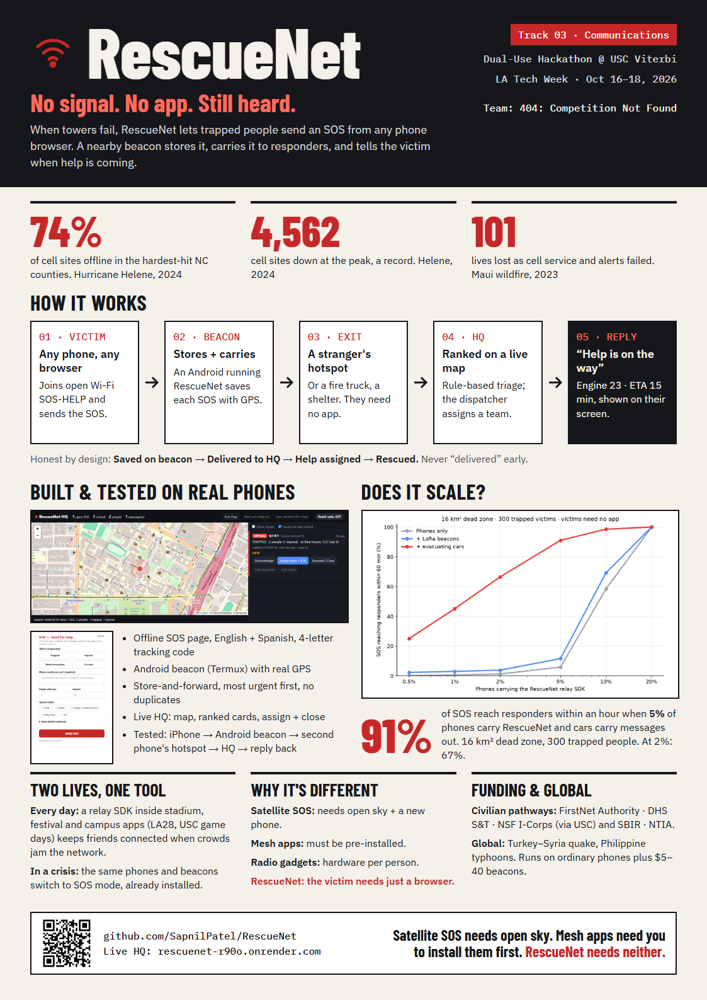

<div align="center">

# 🛰️ RescueNet

### No signal. No app. Still heard.

**An SOS that works when the towers don't, from any phone's browser.**

[](https://rescuenet-r90o.onrender.com)


*Built in 48 hours by **404: Competition Not Found** · Dual-Use Hackathon @ USC Viterbi · LA Tech Week 2026 · Track 03: Communications*

</div>

---

## The problem

| 🌀 Hurricane Helene, 2024 | 🔥 Maui wildfire, 2023 |
|---|---|
| **74%** of cell sites in the hardest-hit NC counties went offline; **4,562** sites down at the peak, a record. | Cellular service collapsed, alerts never arrived, 911 was overwhelmed. **101 lives lost.** |

The people who need help most are **trapped indoors, on whatever phone they have, with no app installed**:

- 🛰️ **Satellite SOS** needs open sky and a new phone. It fails under roofs, rubble and trees.
- 📱 **Mesh-chat apps** only work if *everyone* installed them *before* the disaster.
- 📻 **Radio gadgets** need extra hardware for every person.

> **Satellite SOS needs open sky. Mesh apps need you to install them before the disaster. RescueNet needs neither.**
> You don't need our app to be rescued, but someone near you does: a beacon, a fire truck, or a neighbor's phone.

---

## How it works



1. **A beacon** broadcasts an open Wi-Fi network called **SOS-HELP**.
2. **Anyone nearby** joins it and sends an SOS from the browser: *Trapped · Injured · Need evacuation · I'm safe*, plus where they are. English and Spanish.
3. **The beacon stores it** (with GPS) and **carries it** until it touches *any* internet: a passer-by's hotspot, a fire truck, a shelter.
4. **HQ ranks it** with transparent rule-based triage and pins it on a live map.
5. **The answer rides back the same way.** The victim sees *"Help is on the way: Engine 23 · ETA 15 min."*

**Honest by design:** `Saved on beacon` → `Delivered to HQ` → `Help assigned` → `Rescued`. We never say "delivered" before HQ confirms it.

---

## 🔴 Live demo

**HQ dashboard: [rescuenet-r90o.onrender.com](https://rescuenet-r90o.onrender.com)**

> Hosted on Render's free tier: the first load after it's been idle can take up to a minute while it wakes up. The data resets whenever the server restarts.

The SOS page runs **on the beacon phone itself** (it has to work with no internet), so it isn't hosted online. Try it locally in two commands (see [Run it yourself](#-run-it-yourself)) or on an Android phone with [the Termux guide](docs/android-termux-setup.md).

---

## 📸 Screenshots

<p align="center"><b>HQ dashboard</b>: SOS ranked by urgency, pinned by beacon GPS, grouped by area</p>



<table>
  <tr>
    <th align="center">1 · Send from any browser</th>
    <th align="center">2 · Saved on the beacon</th>
    <th align="center">3 · Help is on the way (Spanish)</th>
  </tr>
  <tr>
    <td></td>
    <td></td>
    <td></td>
  </tr>
  <tr>
    <td align="center"><sub>No app, no account, no signal.</sub></td>
    <td align="center"><sub>Never claims "delivered" early.</sub></td>
    <td align="center"><sub>The dispatcher's answer comes back to the victim.</sub></td>
  </tr>
</table>

---

## ✨ Features

| | |
|---|---|
| 📶 **Works with zero internet** | The SOS page is fully inline (no CDNs, no external files) and served by the beacon itself. |
| 📦 **Store-and-forward** | Every SOS is saved in SQLite on the beacon and survives signal loss. It uploads the moment any internet appears. |
| 🚨 **Most urgent first** | Trapped and oxygen-dependent SOS upload before "I'm safe" check-ins. |
| 🔁 **No duplicates** | Unique IDs make double taps and re-uploads harmless (idempotent HQ API). |
| 🧭 **Real location** | Beacon GPS through Termux:API, plus the victim's own description of where they are. |
| ⚖️ **Transparent triage** | Rule-based scoring: status, injured count, oxygen / child / elderly / wheelchair, danger words in English and Spanish. Trapped + anyone injured = **critical**. |
| 🗺️ **Live HQ map** | Leaflet + OpenStreetMap, severity-sorted cards, area summaries like *"4 SOS, 7 people, 1 trapped, 1 on oxygen"*. |
| ↩️ **Closes the loop** | Acknowledge → Assign team + ETA → Rescued. The update flows back to the victim's screen. |
| 🌎 **Bilingual** | English / Español, picked automatically from the phone's language. |
| 🛡️ **Abuse limits** | Per-device rate limit, optional beacon key and dispatcher token. |

---

## 📈 Does it scale?

We simulated a **16 km² dead zone** with **300 trapped people** over **60 minutes** (2,000 people/km², 80 m phone range).

<p align="center"></p>

| Phones carrying RescueNet | Phones only | + LoRa beacons | + evacuating cars |
|:---:|:---:|:---:|:---:|
| 2% | 1.3% | 3.9% | **66.5%** |
| 5% | 5.9% | 11.6% | **91.1%** |
| 10% | 58.4% | 69.3% | **98.5%** |

**With 5% of phones carrying RescueNet and cars carrying messages out, about 9 in 10 SOS reach responders within an hour, and victims install nothing.** Reproduce it with `python sim/simulate.py --seeds 5`.

---

## 🧩 Two lives, one tool

| Every day | In a crisis |
|---|---|
| A relay SDK inside stadium, festival and campus apps (USC game days, **LA28**) keeps friends connected when crowds jam the network. Beacons at trailheads act as an offline check-in for rangers. | The **same** phones and beacons switch to SOS mode. They're already installed and trusted before disaster hits. |

---

## 🏗️ Architecture

```
rescuenet/
├── beacon/              Flask app that runs on the Android phone (Termux)
│   ├── app.py           SOS page server, SQLite outbox, uploader loop, GPS, captive-portal routes
│   ├── sos_page.html    The victim's page: inline HTML/CSS/JS, English + Spanish
│   └── termux-setup.sh  One-command phone setup
├── hq/                  FastAPI service (deployed on Render)
│   ├── main.py          API, SQLite store, area clustering
│   ├── triage.py        Rule-based severity scoring
│   ├── retell.py        Voice-call integration (coded, switched off)
│   └── static/          Dashboard + bundled Leaflet
├── sim/simulate.py      Delivery-vs-adoption simulation
├── tests/test_e2e.py    9 end-to-end tests against a real HQ server
└── docs/                Concept, research, runbooks, poster
```

| Component | Stack |
|---|---|
| Beacon | Python · Flask · SQLite · requests · Termux + Termux:API |
| SOS page | Vanilla HTML / CSS / JavaScript (zero dependencies) |
| HQ | Python · FastAPI · Pydantic · SQLite · Uvicorn · Render |
| Dashboard | JavaScript · Leaflet.js · OpenStreetMap |
| Simulation | NumPy · SciPy · Matplotlib |

<details>
<summary><b>API reference</b></summary>

| Method | Path | Used by |
|---|---|---|
| `POST` | `/api/v1/incidents` | Beacon upload (idempotent on `message_id`; `X-Beacon-Key` if `BEACON_KEY` is set) |
| `GET` | `/api/v1/updates?beacon_id=` | Beacon pulls acknowledgements and assignments |
| `GET` | `/api/v1/incidents` · `/api/v1/areas` | Dashboard |
| `POST` | `/api/v1/incidents/{id}/ack` · `/assign` `{team, eta_min}` · `/close` | Dispatcher (`X-Dispatch-Token` if `DISPATCH_TOKEN` is set) |
| `GET` | `/api/v1/config` · `/api/v1/health` | Dashboard, monitoring |

Beacon delivery states: `saved_on_beacon` → `uploaded` → `hq_confirmed`.
</details>

---

## 🚀 Run it yourself

```bash
git clone https://github.com/SapnilPatel/RescueNet.git && cd RescueNet
python -m venv .venv && source .venv/bin/activate        # Windows: .venv\Scripts\activate
pip install -r requirements-dev.txt

uvicorn hq.main:app --port 8000                          # HQ dashboard → http://localhost:8000
HQ_URL=http://127.0.0.1:8000 python beacon/app.py        # SOS page     → http://localhost:8080
python -m pytest                                         # 9 end-to-end tests
```

No API keys needed.

**On a real Android phone** (the beacon): install Termux and Termux:API from GitHub, then run

```bash
curl -sL https://raw.githubusercontent.com/SapnilPatel/RescueNet/main/beacon/termux-setup.sh | bash
```

Full guide: [docs/android-termux-setup.md](docs/android-termux-setup.md) · Deploying HQ: [docs/render-deploy.md](docs/render-deploy.md)

---

## 🗺️ Roadmap

- [x] Offline browser SOS page (English + Spanish)
- [x] Android beacon with GPS and store-and-forward
- [x] Live HQ with rule-based triage, map, assign / close
- [x] Reply path back to the victim
- [x] Tested on real phones: iPhone → Android beacon → second phone's hotspot → HQ → back
- [ ] **$5 ESP32 beacons** that pop up the SOS page automatically, like airport Wi-Fi
- [ ] **Android relay SDK** (Bluetooth / Wi-Fi Direct) for phone-to-phone multi-hop
- [ ] **LoRa / Meshtastic** long-range links between fixed beacons
- [ ] **Voice alerts with Retell AI** (integration coded, not yet activated)
- [ ] Signed packets, battery-aware relaying

---

## 🖼️ Poster

<p align="center"></p>

---

<div align="center">

**404: Competition Not Found** · Dual-Use Hackathon @ USC Viterbi · LA Tech Week 2026

*You don't need our app to be rescued, but someone near you does.*

</div>
